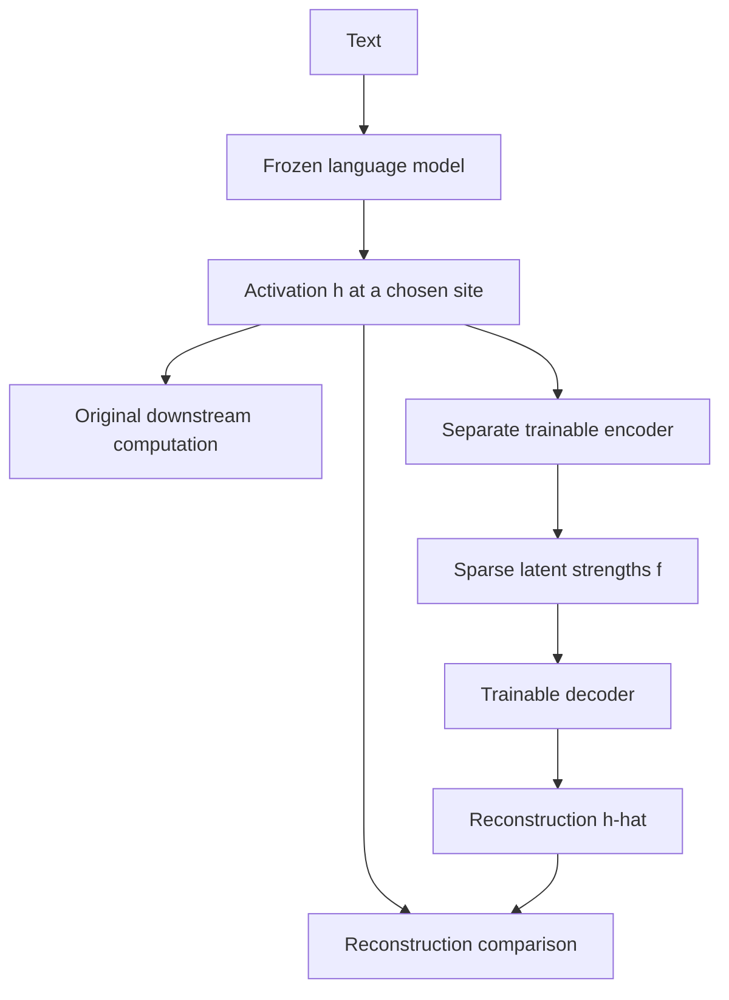
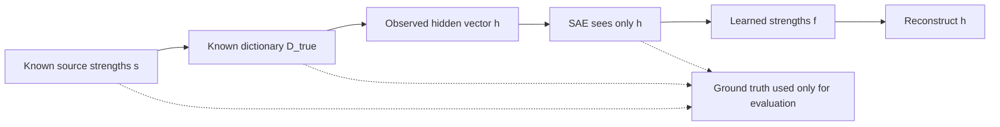
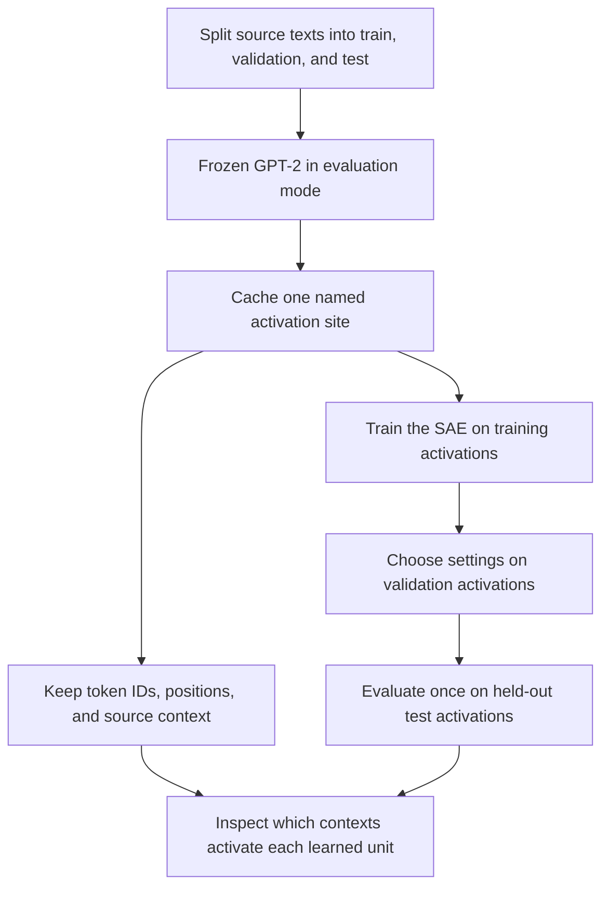

# Sparse Autoencoders

Suppose an activation-patching experiment changes a model's answer. We have learned that the substituted state matters in that experiment. But the state is a vector of hundreds of numbers. Which information did we move?

A sparse autoencoder approaches this second question. It tries to describe an activation using a small collection of reusable features, rather than treating each coordinate as an unexplained number. The idea is simple enough to draw in a plane, but its meaning depends on several distinctions: a feature is not necessarily a neuron, reconstruction is not interpretation, and an interpretable description is not yet a causal explanation.

We will build the method from those distinctions, train a small example whose underlying factors are known, and then connect the same procedure to activations from a frozen language model. The final step returns to ‣: once a representation suggests a feature, what happens when we intervene on its contribution?

## A coordinate is not a concept

Imagine inspecting a hidden activation:

$$
h=\begin{bmatrix}0.8\\-0.3\\1.2\\0.4\end{bmatrix}.
$$

Its entries are coordinates in a representation space. Nothing in the first number tells us that it means “a person's name,” and nothing in the third says “the recipient of an action.” Those interpretations would need evidence about how the values change across inputs and how the network uses them.

A **feature** is a property represented in the computation. It might concern a grammatical construction, an entity, a formatting pattern, or something less easy to name. Its **activation strength** varies with the input. In a linear representation model, its **direction** specifies how that feature contributes across the coordinates of the hidden vector.

A feature can therefore involve many coordinates. Conversely, one coordinate can mix contributions from several features. A neuron is called **polysemantic** when its responses involve several distinguishable features rather than one coherent property. Residual-stream coordinates and hidden MLP neurons should not be conflated: an MLP neuron is an architectural unit with its own nonlinearity, whereas a residual coordinate is an axis of the state being passed between components.

Before invoking superposition, there is a simpler geometric possibility worth understanding.

## Rotate the axes without losing the features

Suppose two features are represented by orthogonal unit directions:

$$
d_1=\frac1{\sqrt2}\begin{bmatrix}1\\1\end{bmatrix},\qquad
 d_2=\frac1{\sqrt2}\begin{bmatrix}-1\\1\end{bmatrix}.
$$

If their strengths are $`s_1`$ and $`s_2`$, the hidden activation is:

$$
h=s_1d_1+s_2d_2
=\frac1{\sqrt2}\begin{bmatrix}s_1-s_2\\s_1+s_2\end{bmatrix}.
$$

Both coordinates mix the features. Yet the features are perfectly separable: $`d_1^\top h=s_1`$ and $`d_2^\top h=s_2`$. The coordinate axes were simply not aligned with the feature directions.

This is a distributed representation, but it is **not yet superposition**. We still have two independent directions in two dimensions. Calling every mixed coordinate “superposition” would miss the stronger claim that motivates sparse feature discovery: useful feature directions may outnumber the dimensions of the space.

## Put three directions into two dimensions

Now choose three unit vectors, with 120 degrees between each pair:

$$
d_1=\begin{bmatrix}1\\0\end{bmatrix},\qquad
 d_2=\begin{bmatrix}-1/2\\\sqrt3/2\end{bmatrix},\qquad
 d_3=\begin{bmatrix}-1/2\\-\sqrt3/2\end{bmatrix}.
$$

Let their strengths be nonnegative. Encode them by a weighted sum:

$$
h=s_1d_1+s_2d_2+s_3d_3=Ds,
\qquad D=[d_1\ d_2\ d_3]\in\mathbb R^{2\times3}.
$$

Read this equation literally. Each column of $`D`$ is a direction in the hidden space. Each entry of $`s`$ says how much of that direction to add. The result $`h`$ has only two coordinates, even though there are three possible ingredients.

In this constructed example, we choose $`D`$ and $`s`$, so the equation defines the encoding exactly. For a real transformer, $`h\approx Ds`$ is a **proposed description** of a representation. It is not a claim that the transformer explicitly stores variables named “country,” “name,” and “emotion” and multiplies them by a separate feature dictionary.

What have we gained by adding a third direction? We have another possible way to represent a feature. What have we lost? The guarantee that every combination is distinguishable.

### A collision that no decoder can repair

The directions satisfy:

$$
d_1+d_2+d_3=0.
$$

Therefore, $`s=(1,1,1)^\top`$ and $`s=(0,0,0)^\top`$ produce the same hidden vector. Any deterministic decoder receiving only $`h=0`$ must give the same answer for both. A larger decoder cannot reconstruct a distinction that the encoding erased.

More generally, a matrix with more columns than rows has a nontrivial nullspace. That prevents a universal inverse over unrestricted coefficients. But our data need not contain unrestricted combinations.

Suppose at most one of the three features is active at a time. Each nonzero vector lies on a distinct ray, so its direction identifies the feature and its length identifies the strength. The ambiguous all-active case is excluded by the data distribution.

**Sparsity changes which inputs need to be distinguished; it does not create additional independent dimensions.** When more features co-occur, recovery depends on the dictionary geometry and the allowed combinations. Sparsity helps, but is not an unconditional recovery guarantee.

The interactive view below begins with the rotated two-feature example. Move to the second tab to combine three directions. Compare “one active,” “two active,” and especially “all active” versus “none active.” The third tab will become useful when we derive the loss.

sae-explorer.html

*The display evaluates constructed geometry and an exact scalar objective. It does not train an SAE or inspect a language model.*

### Where interference enters the calculation

Try to read feature 1 by projecting $`h`$ onto $`d_1`$. Because the directions have unit length:

$$
d_1^\top h=s_1-\tfrac12s_2-\tfrac12s_3.
$$

The desired signal is $`s_1`$. The other terms are interference from features whose directions are not orthogonal to it. In general:

$$
d_i^\top h=s_i+\sum_{j\ne i}s_j(d_i^\top d_j).
$$

If only feature 1 is active at strength one, the three projections are $`(1,-1/2,-1/2)^\top`$. Applying ReLU removes the negative entries and recovers $`(1,0,0)^\top`$. If features 1 and 2 are both active, the same procedure returns $`(1/2,1/2,0)^\top`$, not their original strengths.

The lesson is not “ReLU solves superposition.” It is that a nonlinear readout can reject some interference on a restricted distribution while failing on other mixtures. Toy Models of Superposition studies this trade-off in trained toy networks. The triangle is a way to understand the trade-off, not a claim that every LLM organizes features at these particular angles.

- Does sparsity mean each feature direction has many zero coordinates?
    
    Not here. It means few feature strengths are nonzero on a particular example. A direction can be dense, affecting many coordinates, while its coefficient is usually zero. Sparse coefficients and sparse directions are different properties.
    

## Turn the representation problem around

So far, we knew the feature directions and created a hidden vector. In interpretability, we receive the hidden vector and must investigate possible explanations for it.

If the dictionary $`D`$ were known, we could seek nonnegative coefficients that reconstruct the observation while keeping their total magnitude small:

$$
s^*=\arg\min_{s\geq0}\left[\|h-Ds\|_2^2+\lambda\|s\|_1\right].
$$

This is a sparse-coding objective. Reconstruction asks whether the proposed ingredients reproduce the observation. The second term favors lower total coefficient magnitude. Across many observations, we can also learn the dictionary itself.

A **sparse autoencoder**, or SAE, learns a network that computes a sparse code directly. Instead of solving a fresh iterative optimization problem for each activation, its encoder produces a candidate code in one forward pass. That code is learned jointly with the decoder and need not be the exact minimizer of the sparse-coding problem above.

The important change of notation is deliberate: let the SAE produce $`f(h)`$, not the original synthetic $`s`$. We do not yet know whether its learned units correspond to the factors that generated the data.

## Build the encoder and decoder

Take an observed activation $`h\in\mathbb R^d`$. Choose $`K`$ candidate latent units. A common centered ReLU SAE computes:

$$
f(h)=\mathrm{ReLU}\left(W_{\mathrm{enc}}(h-b_{\mathrm{dec}})+b_{\mathrm{enc}}\right),
$$

$$
\hat h=W_{\mathrm{dec}}f(h)+b_{\mathrm{dec}}.
$$

The hat distinguishes the reconstruction from the original activation. The decoder bias supplies a learned baseline; subtracting it before encoding gives the encoder a centered input. This is one useful architecture, not a definition that every SAE must follow.

| Quantity | Shape | Meaning |
| --- | --- | --- |
| h | d | The activation observed in the original network |
| W_enc | K × d | Learned SAE weights that read the activation |
| f(h) | K | Input-dependent strengths of the learned latents |
| W_dec | d × K | Learned dictionary; one output direction per column |
| h-hat | d | The reconstruction being compared with h |

A single latent makes the computation especially clear. Let $`e_k^\top`$ be encoder row $`k`$ and $`d_k`$ decoder column $`k`$:

$$
f_k(h)=\max\left(0,e_k^\top(h-b_{\mathrm{dec}})+b_{\mathrm{enc},k}\right).
$$

The encoder row and bias determine **when the latent activates**. The decoder column determines **what its activation writes into the reconstruction**:

$$
\hat h=b_{\mathrm{dec}}+\sum_{k=1}^K f_k(h)d_k.
$$

These are different jobs. The encoder need not be the transpose or inverse of the decoder. Simply taking dot products with decoder directions generally does not reproduce the trained encoder's output.

The original transformer's weights remain frozen. We train a second model on values computed by the first:



*The analysis branch does not alter the language model's output. Replacing an activation with a reconstruction is a separate experiment.*

### Why expand into more units than the input has dimensions?

An SAE with $`K>d`$ is **overcomplete**. For example, 12 learned directions can describe four-dimensional activations, with each input using only a few directions.

This offers a larger vocabulary of possible ingredients, not more information than was present in the input. The directions are linearly dependent. “Dictionary” is therefore a better word than “basis,” which would imply linear independence.

Nor does the SAE discover 12 new physical neurons hidden inside the original network. Its 12 latents belong to the separate interpretability model. Whether they correspond to useful features is the question being tested.

## Understand what training rewards

For a dataset of activations, use the objective:

$$
\mathcal L=\mathbb E_h\left[\underbrace{\|h-\hat h\|_2^2}_{\text{reconstruction error}}+\lambda\underbrace{\sum_k|f_k(h)|}_{\text{activation cost}}\right].
$$

The first term penalizes information lost in reconstruction. The second discourages using large total latent activity. Their competition matters: with no pressure toward sparse codes, the model can distribute information across many units; with excessive pressure, it can suppress useful activity and reconstruct poorly.

Neither term directly says “learn concepts a person can name.” Interpretability is an outcome to investigate, not a label supplied to training. Towards Monosemanticity examines features learned through sparse dictionary learning in a small transformer and evaluates their behavior beyond reconstruction alone.

### L1 is a magnitude penalty, not a count

Compare coefficients $`(0.6,0.6)`$ and $`(2,0)`$. Their L1 costs are 1.2 and 2, respectively. The first code has more active units but the smaller penalty.

L1 can encourage sparsity, especially with a gate that produces exact zeros, but it is not the same as the number of nonzero latents. Measure that count separately. In numerical code, state whether activity means strictly greater than zero or greater than a small threshold such as $`10^{-6}`$.

### Derive the trade-off in one dimension

Let the dictionary contain one known unit direction $`d`$, the observation be $`h=td`$ with $`t\geq0`$, and the reconstruction be $`fd`$. Then:

$$
\mathcal L(f)=(t-f)^2+\lambda f,\qquad f\geq0.
$$

In the positive region, differentiating gives $`2(f-t)+\lambda=0`$. Enforcing nonnegativity yields:

$$
f^*=\max(0,t-\lambda/2).
$$

The optimum shrinks the coefficient before it eventually becomes zero. Thus some reconstruction error is built into the regularized optimum; it need not be an implementation bug. The factor of two comes from our squared-error convention. Adding a one-half factor or averaging differently changes the numerical scale of $`\lambda`$.

Return to the third tab of the interactive display. Increasing the penalty moves the minimizing coefficient toward zero. The plot is the exact scalar objective, not a claim that a whole trained dictionary must follow the same curve.

### Close the scaling loophole

If a decoder direction becomes $`cd_k`$ and its activation becomes $`f_k/c`$ for positive $`c`$, their product is unchanged. Reconstruction stays the same, but the L1 cost decreases as $`c`$ grows.

Without a scale constraint or an equivalent correction, training can exploit this loophole instead of finding a meaningfully sparser description. One remedy is to constrain decoder columns to unit length. The implementation below renormalizes them after every optimizer step.

Changing the activation scale also changes the practical meaning of $`\lambda`$. Two runs are not a clean sparsity comparison if one uses different preprocessing or different loss reductions. Keep those conventions fixed and report reconstruction and activity separately from the combined objective.

- Do all SAEs use ReLU and an L1 penalty?
    
    No. TopK-based SAEs, for example, select a limited number of latent activities directly. Other approaches change the gate or regularization. The encode–decode problem remains, but its optimization and trade-offs change. Gao and colleagues' paper, linked below, studies these alternatives and their evaluation. Understanding the simple ReLU objective gives us a concrete starting point rather than the final word.
    

Scaling and evaluating sparse autoencoders develops this broader architecture-and-evaluation perspective.

## Train an SAE where the answer is known

A controlled experiment gives us an advantage we do not have inside an LLM: we can know the source factors before hiding them from the learner.

Construct eight unit directions in four dimensions. On each example, independently activate each source feature with probability 0.08 and assign active features a strength between 0.5 and 1.5. Add their contributions to obtain a four-dimensional hidden vector.

Now give the SAE only those hidden vectors. Do not give it the eight directions or the source strengths as labels. Let it learn a 12-unit dictionary by reconstruction and activation cost. After training, bring the answer key back to evaluate its proposal.



### Generate the observations

In the code, examples are rows. `dictionary` has shape `[4, 8]`, so multiplying by its transpose is the batch version of $`h=D_{\mathrm{true}}s`$:

```python
dictionary = F.normalize(torch.randn(4, 8), dim=0)
mask = (torch.rand(batch_size, 8) < 0.08).float()
strengths = 0.5 + torch.rand(batch_size, 8)
source_features = mask * strengths
hidden = source_features @ dictionary.T
```

The mask expresses **which features are present**. The strengths express **how active they are**. The matrix expresses **how they are encoded**. Only `hidden` becomes the SAE's input. The complete attached source controls all random generators explicitly.

### Translate the encoder–decoder equations into PyTorch

```python
self.encoder = nn.Linear(width, latents)
self.decoder = nn.Linear(latents, width, bias=False)
self.center = nn.Parameter(torch.zeros(width))
```

For `width=4` and `latents=12`, the encoder weight is `[12, 4]` and the decoder weight is `[4, 12]`. A forward pass is:

```python
features = F.relu(self.encoder(hidden - self.center))
reconstruction = self.decoder(features) + self.center
```

`nn.Linear` handles the transpose needed for row batches internally. Its encoder bias supplies $`b_{\mathrm{enc}}`$; `center` is the decoder baseline subtracted and added in the equations. The decoder has no separate bias because `center` already plays that role.

### Train on the observation, not the answer key

```python
hidden, _ = sample(256, dictionary, stream)
reconstruction, features = sae(hidden)

reconstruction_loss = (
    (hidden - reconstruction).square().sum(-1).mean()
)
activation_cost = features.abs().sum(-1).mean()
loss = reconstruction_loss + penalty * activation_cost

optimizer.zero_grad(set_to_none=True)
loss.backward()
optimizer.step()
sae.normalize_decoder()
```

The underscore discards the source coefficients. The reconstruction target is `hidden` itself, not the source feature vector. Backpropagation updates only the SAE's encoder, decoder, and biases. Normalizing decoder columns prevents the rescaling shortcut.

This code **imposes superposition in the data generator** and investigates whether sparse dictionary learning can recover its directions. It does not show a transformer spontaneously learning superposition. Those are different experiments.

### The complete executable example

sae-example.txt

Save the attachment as `sae_example.py`. It trains two SAEs on CPU, using the same initialization and training examples but different penalties, and writes evaluation results to `sae_results.json`. No model download is required.

Both runs use 2,000 optimization steps, batches of 256, Adam with learning rate 0.003, and 12 latent units. Evaluation uses 4,096 freshly sampled observations from a separate random stream. The following measurements were obtained with PyTorch 2.10.0 on CPU:

| Held-out measurement | λ = 0.005 | λ = 0.08 |
| --- | --- | --- |
| Mean squared vector reconstruction error | 0.000629 | 0.003940 |
| Variance accounted for | 99.90% | 99.38% |
| Mean active latents, threshold 10⁻⁶ | 4.91 of 12 | 1.87 of 12 |
| Mean best direction cosine | 0.810 | 0.928 |
| Reconstruction error on nonempty source examples only | 0.001287 | 0.007931 |

The stronger penalty produced a sparser code with worse reconstruction. In this particular experiment, its decoder directions also matched the planted directions better by the reported cosine diagnostic. That last result is not a theorem that more sparsity always improves feature recovery.

The data contain an important qualification: **51.3% of the held-out examples had no active source features**, and the true mean number active was about 0.64. The easy all-zero cases help the overall reconstruction average. Reporting the nonempty subset prevents that average from hiding a harder reconstruction problem.

For each of the eight true directions, the cosine diagnostic finds the closest of the 12 learned directions and then averages. This is not a one-to-one matching: multiple source directions could select the same learned unit. A score near one is evidence of alignment, not proof that every source has been independently recovered.

Nor is the learned 12-entry vector an element-by-element estimate of the eight-entry source vector. Unit ordering is arbitrary; features may split, combine, or duplicate. The measured 1.87 active latents versus 0.64 active sources is itself evidence that the learned code has not simply reproduced the original code.

These are measurements of **one synthetic dictionary and controlled training setup**. Repeating dictionaries and optimization seeds would be needed to establish a more general trend. There are no semantic labels such as “Python” or “names” in this random-direction experiment.

## Replace the synthetic generator with a frozen language model

The real-model workflow changes where the observations come from, not the fundamental training objective.

Run text through frozen GPT-2 and collect activations from **one precisely specified site**. For example, use the residual stream entering a chosen transformer block. Every retained token position supplies one 768-dimensional example. The SAE learns to reconstruct those vectors, not to predict the next token directly.

The site must remain fixed. An SAE trained on a block input is not automatically appropriate for that block's output, an MLP activation, or another model checkpoint. Shape compatibility does not establish distribution compatibility.

A collection pipeline separates three responsibilities:



Split at the text or document level before extracting activations. Randomly dividing neighboring token vectors from the same passage can put closely related contexts on both sides of the split. Preserve the attention mask and exclude padded positions. Decide consistently how to handle special tokens such as BOS; a feature dominated by a special token is not automatically a semantic discovery.

For a causal language model, a feature at a token position has access to that token and its preceding context, not future tokens. Displaying a whole sentence can make an interpretation look stronger than the information available at the activated position actually permits.

### Cache once, then train the smaller model

Activation extraction is an inference job. SAE optimization can operate on the cached vectors afterward, without rerunning GPT-2 for every optimizer step. This separates the expensive source of the data from the relatively small network being trained.

As a size calculation, 100,000 vectors of width 768 stored in float32 occupy **307.2 MB** before metadata. A 768-input, 1,536-latent version of our SAE has **2,361,600 trainable parameters**, counting its two matrices and biases. These are memory and parameter calculations, not runtime or feature-quality guarantees.

It is unnecessary to retain every layer or to save a dense table of every latent activation for every token. Stream small batches; keep the selected-site activation cache, compact metrics, and top-activating examples. Use float32 for the simple training objective even if a cache is stored more compactly, unless a separately validated mixed-precision setup is used.

A small training budget can demonstrate reconstruction and sparsity without producing a mature, generally interpretable feature dictionary. The relevant question is what the experiment actually learns, not whether its feature labels resemble those from much larger published runs. Free Colab's resources and session limits vary, as described in its official FAQ; save the activation cache and checkpoints outside temporary runtime storage.

### Keep preprocessing part of the model definition

Centering and scaling change the values the SAE sees. Fit any preprocessing on the training data and reuse exactly the same transformation for validation, testing, and interventions. Do not independently normalize each new dataset and then compare its activations as though the scale were unchanged.

If $`\tilde h=(h-\mu)/s`$ uses a saved scalar scale $`s>0`$, a decoder edit $`\Delta\tilde h`$ corresponds to an original-space edit $`s\Delta\tilde h`$. Forgetting this conversion changes the intervention strength. With more general preprocessing, use the appropriate inverse map.

Record the model and tokenizer identifiers, exact site, token-selection rule, preprocessing, training configuration, and random seeds. Saving the optimizer and random states as well as the weights makes a resumed run a continuation rather than an unexplained restart.

## Evaluate four different properties separately

An SAE can succeed at one objective and fail at another. Do not compress all the following questions into “the loss looks good.”

### Does it reconstruct unseen activations?

For test examples $`h_i`$, report the squared vector error and, when useful, a variance-normalized measure:

$$
\mathrm{VAF}=1-\frac{\sum_i\|h_i-\hat h_i\|_2^2}{\sum_i\|h_i-\bar h_{\mathrm{test}}\|_2^2}.
$$

This definition uses the test mean for the denominator. It is undefined when the denominator is zero and can be negative if reconstruction is worse than the mean baseline. State the convention instead of reporting an unexplained “accuracy.”

### Is its code sparse and are units being used?

Measure the average number of active latents and their activation frequencies. A unit that never activates on a finite evaluation sample is inactive **on that sample**; that is not proof that no possible input activates it.

Also inspect whether activity is concentrated in a few units or spread across the dictionary. Very dense codes and mostly unused dictionaries can reveal different optimization problems. Compare penalty settings on the same scale and the same held-out examples.

### Does reconstruction preserve behavior the original model cares about?

Optionally replace the original activation with the SAE reconstruction and run the original downstream model. Compare next-token loss or a specific answer contrast before and after this replacement.

This tests behavioral preservation beyond geometric reconstruction. A small error in a direction that the downstream network amplifies may matter more than a larger error in an ignored direction. Conversely, good behavior on a selected task does not establish that all represented information has been retained.

A reconstruction substitution changes many latent contributions and the reconstruction error together. It is **not** a selective causal test of one feature.

### Do learned units support stable interpretations?

Inspect contexts that activate a unit, then test the resulting hypothesis on new examples. Good reconstruction, sparse activity, and a plausible English description answer different questions. The multi-property evaluation in Scaling and evaluating sparse autoencoders is useful precisely because a single proxy cannot stand in for all of them.

## Give a feature a hypothesis, not a permanent name

Suppose a unit activates around several Python snippets. One interpretation is “Python programming.” Others include indentation, function definitions, quotation marks, or code in general.

Distinguish these accounts using matched contrasts. Compare Python with another programming language, Python mentioned in prose with Python syntax, and similar formatting with different content. Track activation at a defined token or a clearly specified aggregation. Taking the maximum over an arbitrarily long passage gives that passage more opportunities to produce a high value.

The semantic label comes **after** training. It is a hypothesis inferred from observations, not a supervisory label that made the SAE learn a Python unit. A failed hypothesis can teach more than another supportive example.

Neuronpedia's feature dashboards make these observations accessible: a model and feature source identify the dictionary; a feature index identifies one latent; highlighted contexts show where it activates. An automatically generated explanation is a proposed interpretation, not ground truth.

A feature index is not a universal concept ID. Unit 583 in one dictionary need not correspond to unit 583 in another. Direction similarity, activation patterns, and intervention behavior provide more meaningful comparisons than indices or labels alone.

- Does an active feature prove the model uses that feature to produce its answer?
    
    No. It shows that the learned encoder detects a pattern at the selected site. Establishing a role in the model's behavior requires an intervention with an appropriate comparison. Detecting country names is not the same as showing that the feature retrieves capitals.
    

## Return to causality, now with a more specific edit

The decoder gives us a way to translate a latent change back into the original activation space. Write:

$$
\hat h=b_{\mathrm{dec}}+\sum_k f_k(h)d_k,\qquad e=h-\hat h.
$$

Here $`e`$ is the reconstruction error. Suppose we replace latent $`k`$'s coefficient by a chosen value $`c`$ while retaining the other coefficients and this error. The new state is:

$$
\begin{aligned}
h'&=b_{\mathrm{dec}}+\sum_{j\ne k}f_j(h)d_j+cd_k+e\\
&=h+\bigl(c-f_k(h)\bigr)d_k.
\end{aligned}
$$

This derivation explains why we add the **decoded change to the original activation**, rather than substitute the whole reconstruction. With $`c=f_k(h)`$, the edit is exactly zero even if the SAE reconstructs imperfectly.

Adding a fixed $`\alpha d_k`$ is additive feature steering. Choosing $`c`$ from the corresponding clean run is a form of feature-level patching. Choosing $`c=0`$ removes the selected decoded contribution under this decomposition. The error-preserving approach is used in Scaling Monosemanticity.

But a crucial distinction remains. The decoder change is exactly what the equation states; it is not a guarantee that a human concept has been selectively set to a chosen strength. Re-encoding $`h'`$ can change several latent activations because encoder and decoder directions are not generally inverse or mutually orthogonal. The original downstream network can respond nonlinearly as well.

A whole-vector clean patch and a one-feature patch therefore answer different questions. For a fixed SAE applied at the same site and preprocessing:

$$
h^{c}-h^{r}=W_{\mathrm{dec}}\bigl(f(h^{c})-f(h^{r})\bigr)+(e^{c}-e^{r}).
$$

The full state difference includes every changed latent and the difference between reconstruction errors. A single-feature edit selects one proposed component of that difference. Its success supports an intervention effect along that learned direction; its failure does not erase the whole-vector effect.

## What an SAE has—and has not—explained

We began with a vector whose coordinates had no obvious meaning. Geometry showed why useful properties need not align with those coordinates, and why sparse overlapping directions can offer more representational possibilities than dimensions. The encoder–decoder objective then supplied a method for learning candidate descriptions from observations.

The method gives us a **shared dictionary**, **input-dependent coefficients**, and a **testable approximation** of activations. It does not supply a guaranteed list of the model's unique concepts. Reconstruction asks whether the description preserves a vector; interpretation asks whether its units have coherent behavior; intervention asks what the original model does when the proposed information is changed.

Those questions reinforce one another without becoming interchangeable. The strongest use of an SAE is not to attach convincing names to hidden units, but to make more specific hypotheses about representations—and then test those hypotheses in the original computation.

## Primary readings

Toy Models of Superposition develops the geometric and optimization trade-off. Towards Monosemanticity connects sparse dictionary learning to transformer features. Scaling and evaluating sparse autoencoders studies architectures and evaluation, and Scaling Monosemanticity connects feature analysis to interventions in a larger model. The controlled example in this chapter is much smaller and should not be mistaken for a reproduction of those large-scale results.